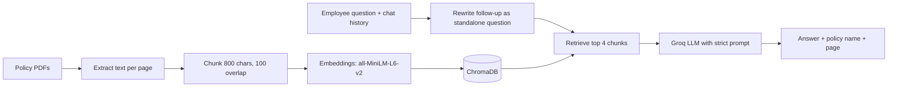

# PolicySense: Intelligent Employee Policy Assistant

PolicySense is a Retrieval-Augmented Generation (RAG) chatbot that answers employee questions about company policies. Every answer is grounded in the approved policy documents and shows the **policy name and page number** it came from. If the documents do not contain the answer, the assistant says so instead of inventing one.

> **Live demo:** `<paste your .streamlit.app link here>`
>
> This is a proof of concept built entirely with free and open-source tools. The company (Nexora Technologies) and all policy documents are **fictional sample data**.

---

## Features

- **Grounded answers**: the LLM only sees the retrieved policy text and is told not to use outside knowledge
- **Source citations**: each answer lists the policy and page used
- **Guardrail**: if no supporting evidence is found, it returns a generic "no answer found" message
- **Conversation memory**: follow-up questions such as "What about paternity?" work, because follow-ups are rewritten into standalone questions before searching
- **Upload a PDF**: add a new policy from the sidebar and the knowledge base is re-indexed
- **Feedback**: thumbs up/down on each answer, saved to `data/feedback.csv`
- **Evaluation script**: measures accuracy on a 30-question test set

---

## How it works



**Key principle:** retrieve the evidence first, then let the LLM write the answer from that evidence only.

| Stage | Details |
|---|---|
| Ingestion | `pypdf` reads each page and keeps `source` and `page` metadata. Repeated headers and footers are removed |
| Chunking | LangChain `RecursiveCharacterTextSplitter`, 800 characters with 100 overlap |
| Embeddings | `sentence-transformers/all-MiniLM-L6-v2`, runs locally on CPU |
| Vector store | ChromaDB (local, persistent) |
| LLM | Groq free tier, model `openai/gpt-oss-120b` (configurable in `.env`) |
| UI | Streamlit chat interface |

---

## Tech stack (all free)

Python 3.10+, LangChain, ChromaDB, sentence-transformers, Groq API (free tier), Streamlit, pypdf, pandas.

---

## Project structure

```
policysense/
├── app.py                  Streamlit UI
├── evaluate.py             Runs the test questions and reports accuracy
├── requirements.txt
├── .env.example            Template for your API key
├── data/
│   ├── policies/           The 8 sample policy PDFs
│   └── eval/
│       └── test_questions.csv
└── src/
    ├── config.py           Paths, model names, chunk size, messages
    ├── ingest.py           PDFs -> chunks -> embeddings -> ChromaDB
    └── rag_chain.py        Retrieval, prompt, memory, sources
```

---

## Sample policies included

1. Work From Home Policy
2. Leave Policy
3. Attendance and Working Hours Policy
4. Expense Reimbursement and Travel Policy
5. Information Security Policy
6. Anti-Sexual Harassment (POSH) Policy
7. Code of Conduct and Ethics Policy
8. Performance Review and Appraisal Policy

---

## Run it locally

### 1. Clone and create a virtual environment

**Windows (PowerShell)**
```powershell
git clone <your-repo-url>
cd policysense
python -m venv venv
venv\Scripts\Activate.ps1
```

**Mac / Linux**
```bash
git clone <your-repo-url>
cd policysense
python3 -m venv venv
source venv/bin/activate
```

### 2. Install dependencies

```bash
pip install -r requirements.txt
```

The first install takes a few minutes because of PyTorch.

### 3. Add your free Groq API key

1. Create a free key at [console.groq.com/keys](https://console.groq.com/keys)
2. Copy `.env.example` to `.env` and fill it in:

```text
GROQ_API_KEY=your_groq_api_key_here
GROQ_MODEL=openai/gpt-oss-120b
```

Groq changes its model catalog often. If you get a `model_not_found` error, run a small script that calls `client.models.list()` to see which models your key can use, then update `GROQ_MODEL`.

### 4. Build the index and test the pipeline

```bash
python -m src.config       # checks the setup
python -m src.ingest       # builds the ChromaDB index
python -m src.rag_chain    # asks 4 sample questions in the terminal
```

### 5. Start the app

```bash
streamlit run app.py
```

Open `http://localhost:8501`.

---

## Evaluation

`evaluate.py` runs the 30 questions in `data/eval/test_questions.csv` and checks:

- **Answer accuracy**: an LLM judge compares each answer with the expected answer
- **Source accuracy**: whether the correct policy appears in the cited sources
- **Guardrail**: out-of-scope questions (for example "Who is the CEO?") must be refused

```bash
python evaluate.py
```

Results of the latest run (replace with your numbers):

| Metric | Result |
|---|---|
| Answer accuracy (in-scope questions) | 25 / 28 (89%) |
| Correct policy cited | 27 / 28 (96%) |
| Out-of-scope questions refused | 2 / 2 |
| Overall | 27 / 30 (90%) |

Per-question details are saved to `data/eval/results.csv`.

---

## Deploy for free on Streamlit Community Cloud

1. Push this repository to GitHub (public). Make sure `.env` is **not** committed
2. Go to [share.streamlit.io](https://share.streamlit.io), sign in with GitHub and click **Create app**
3. Choose the repository, branch `main` and main file `app.py`
4. Open **Advanced settings > Secrets** and add:
   ```toml
   GROQ_API_KEY = "your_groq_api_key_here"
   GROQ_MODEL = "openai/gpt-oss-120b"
   ```
5. Click **Deploy**. The first start takes a few minutes while the embedding model downloads and the index is built

Free apps go to sleep when idle, so the first load after a break can take around 30 seconds.

---

## Example

**Employee:** How many days of WFH am I allowed per month?

**PolicySense:** Up to 8 work-from-home days per calendar month, subject to manager approval and business requirements.

**Sources:** Work From Home Policy, page 1

**Employee:** Who is the CEO of Nexora?

**PolicySense:** Sorry, I could not find an answer to this question in the available policy documents. Please contact HR.

---

## Screenshots

_Add 2 or 3 screenshots here: the chat with a sources expander, a follow-up question, and the no-answer message._

---

## Limitations of this proof of concept

- Uses sample documents only, not real employee data
- No sign-in, so every user sees every policy
- Tables in PDFs are extracted as plain text, which can reduce retrieval quality for table-heavy content
- The free Groq tier has rate limits, and the app shows a friendly message if they are hit
- Answers should be checked against the original policy for important decisions

## Roadmap (Phase 2, after approval)

- Rebuild the same logic on an enterprise platform (for example Microsoft Copilot Studio or AWS Bedrock)
- Connect to Microsoft Teams, Zoho and the company website
- Use live HR data with a full security and compliance review
- Add sign-in based access control so answers respect each user's role
- Add better table extraction and a hybrid (keyword plus vector) search

---

## Author

Built by Madhurima Chatterjee as a proof of concept for an employee policy assistant.